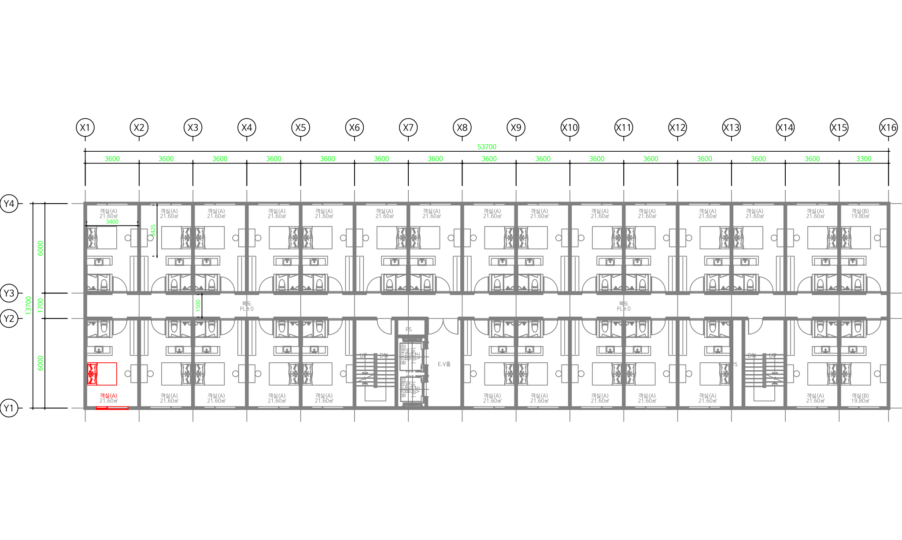
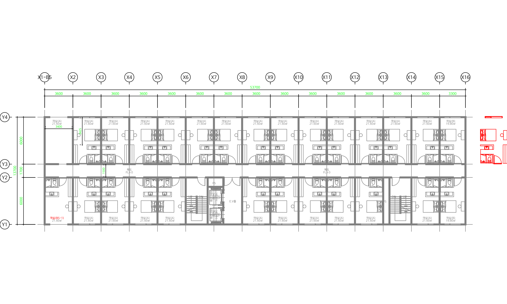
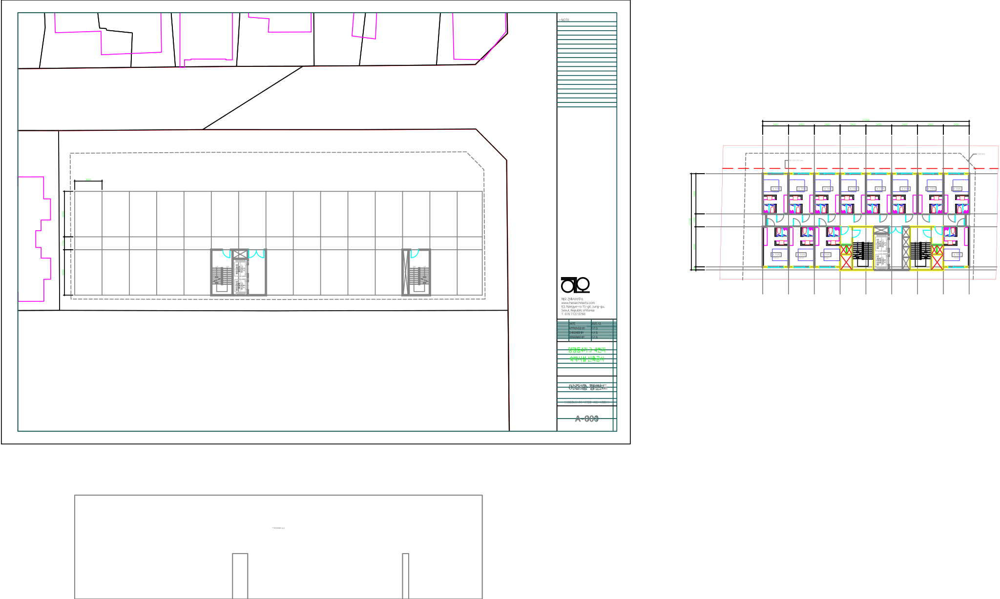
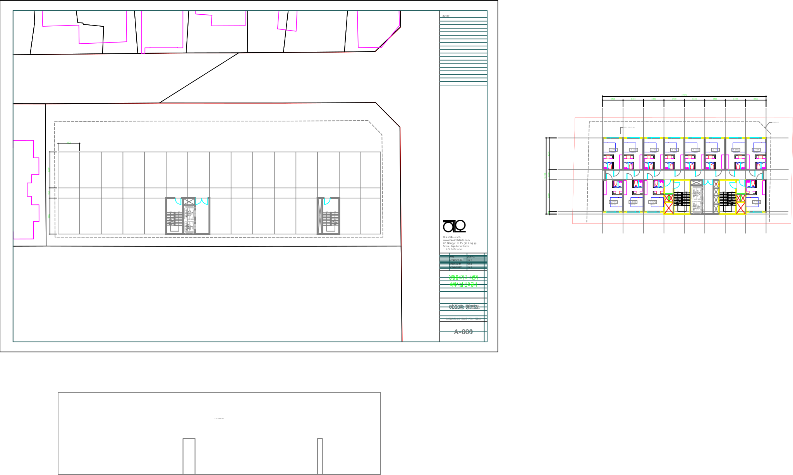

# B5 0-B 통과 시험 기록

상태: **통과(2026-10-18).** GstarCAD 2021 CAD 시험 1건(657단계, 45분 50초)과 공개 MCP stdio 실행(86단계)이 모두 독립 판정을 통과했다. 사용자 열린 도면·원본 파일은 바뀌지 않았다.

`tools/acceptance/b5_dangsan.py`가 CAD 없이 만든 로컬 준비 패키지는 `output/b5/prepared-01/`이다. 입력별 SHA256와 요약 수치는 [결과 JSON](b5-acceptance-results.json), 전체 입력 출처·mtime·대상 목록·산출물 해시는 로컬 manifest에 있다. 대응 DWG는 `output/t10/dangsan-A.dwg`이며 제공된 COM Export 메타와 함께 양쪽 해시를 고정했다. 준비 도구는 CAD에 연결하지 않았다.

사람 확인(2026-10-18, delta [55500, 0]mm 그대로 확정)한 manifest SHA256:

`72781c3b74451fe7110ddd1a2d770f6624b1dd312fc0c0644504ef319c27c58f`

| 요청 | 대상 | 동작 |
|---|---:|---|
| b5-room-move | 637 | 객실 0 전체: LINE 400, LWPOLYLINE 70, ARC 162, CIRCLE 5. delta=[55500, 0]mm |
| b5-annot-edit | 61 | 다른 객실 1의 침대 shape3[0]/ 43개·창 shape5[0]/ 16개 삭제, 공간상 대응 실명·축열 속성 각 1개 변경 |
| b5-human-edit | 3 | 폴리라인 20F2를 [600, -300]mm 이동, 선 20F4 삭제, 문자 2170을 ST → ST B5로 변경 |

실명은 `t10-annotations:text-401E`, `객실(A)` → `객실(B5-1)`이다. 버블은 `t10-annotations:X1`의 `축열` 값 `X1` → `X1-B5`다. 엔진 모형 공간은 총 17,919개이고 그중 T10 태그 객체는 17,366개다. 사람 입력은 좌표를 그대로 두고 원시 DXF 헤더 `$INSUNITS`만 6에서 4로 바꿨다.









객실 0 전체 이동 대상 미리보기는 로컬 `b5-room-move-before.svg`, 전체 사람 확인 요약은 `summary.md`다. 변경 후 이미지는 CAD 시험 사본 A를 DWG로 저장·재열기한 뒤의 Export로 그렸다.

## 결과

| 항목 | 결과 |
|---|---|
| 성공 적용 | 엔진·사람 사본 A/B에서 요청 3개 모두 `success`·`meta.decision=apply`, 독립 기대 도면과 일치 |
| 재전송 | 6회 모두 `success`·`skip`, 도면·기록 불변 |
| 충돌 | 10건 모두 `conflict`, 기대 이유·해당 핸들, 직전 상태 불변. 태그 없는 사람 객체의 기준 이전 수정 1건은 새 기준으로 `success` |
| 실패 주입 | 11건 모두 `recovered`. 같은 핸들·전체 XDATA·형상, 이전 작업 표시선·기존 기록 보존, 새 기록 없음. state 쓰기 뒤 실패는 state 1개·636개를 다시 쓴 상태에서도 복귀 |
| 표준 | 엔진 전체 검사 위반·미검사·잘림 0. 사람 요청은 새 위반 0, 미검사 1종(문자 2170 높이) |
| 저장·재열기 | 4개 사본 모두 핸들·태그·적용 기록 유지. 사람 사본은 블록 정의 내부 2개의 실수 끝자리(최대 4.0e-16) 허용 |
| A/B 독립 | 엔진·사람 모두 의미 경로 대응 일치 |
| 공개 MCP stdio | export_snapshot → apply_changes 3회 → 재전송 → check_standard → DWG 저장 → 다시 열기 대조 통과 |
| 사용자 보호 | 열린 `Drawing1.dwg`의 저장·활성 상태, 원본 입력 해시·mtime 불변 |

요청별 apply 시간(CAD 사본 A, 초, 괄호는 단계 ms):

| 요청 | 전체 | 판정·사전 확인 | 변경 | 사후 확인 | 검사 전·후 | 기록 | 재전송 skip |
|---|---:|---:|---:|---:|---:|---:|---:|
| b5-room-move 637개 | 55.3 | 8,546 | 27,932 | 10,417 | 2,712 / 2,389 | 3,307 | 8.7 |
| b5-annot-edit 61개 | 31.1 | 8,574 | 4,237 | 9,912 | 2,374 / 2,446 | 3,509 | 9.0 |
| b5-human-edit 3개 | 6.9 | 2,257 | 743 | 2,213 | 480 / 349 | 872 | 2.1 |

사본 B와 MCP도 같은 범위다(객실 이동 54.6·54.9초). Export 160회는 0.6~6.3초(평균 2.6초)였다. 637개 이동은 COM Move 한 객체씩이라 변경 단계가 가장 길다.

### 실행 중 발견·수정

1. 1차 실행: 사람 요청 결과의 `unchecked`에 도면 전체 문자 51개가 전·후 두 번 들어가 `new_violations`가 버려졌다. 결과 모델·스킬 정의(요청 범위 미검사)에 맞게 `apply_changes`의 미검사를 변경 대상 범위로 한정했다(PR #37).
2. 2차 실행: 사람 사본 DWG 저장·재열기 뒤 블록 정의 내부 INSERT Z·ELLIPSE 법선의 실수 끝자리가 달랐다. 제품 문제가 아니므로 저장·재열기 비교에만 실수 허용오차를 두었다.
3. 3차 실행 통과. 로그·증거는 로컬 `output/b5/`(cad-run-0N.log, b5-evidence-cad-03.json, b5-mcp-evidence-01.json, 최종 DWG)에 있다.

사람 사본 SVG를 만들 때 ezdxf가 `DIMTXSTY`의 문자 스타일 `#0`을 찾지 못해 해당 재정의를 무시했다는 경고를 남겼다. DXF 데이터는 수정하지 않았다. 사람 확인 때 실제 CAD의 치수 문자 표시도 함께 대조한다.

## 실행 순서 (Claude)

1단계 원·호 관문은 [spike-report.md](spike-report.md)의 “B0 이후 추가 확인”에 별도로 기록되어 있다. 해당 관문이 유효한 상태에서 준비 요약·미리보기를 사람에게 보여 주고 확인받는다. CAD 시험과 공개 MCP stdio는 직렬로 실행한다.

```powershell
$env:ARCAID_CAD_TESTS="1"
$env:ARCAID_B5_PREPARED=(Resolve-Path output/b5/prepared-01).Path
$env:ARCAID_B5_APPROVED_MANIFEST_SHA256="72781c3b74451fe7110ddd1a2d770f6624b1dd312fc0c0644504ef319c27c58f"
# basetemp는 존재하지 않는 새 경로인지 먼저 확인한다.
.venv/Scripts/python.exe -m pytest tests/cad/test_b5_dangsan_cad.py -q -s --basetemp=C:/arcaid/work/b5-cad-NEW
# CAD 시험이 끝난 뒤에만 실행. --work도 존재하지 않는 새 경로다.
.venv/Scripts/python.exe tools/acceptance/b5_dangsan.py mcp output/b5/prepared-01 --work C:/arcaid/work/b5-mcp-NEW
Remove-Item Env:ARCAID_CAD_TESTS -ErrorAction SilentlyContinue
Remove-Item Env:ARCAID_B5_PREPARED -ErrorAction SilentlyContinue
Remove-Item Env:ARCAID_B5_APPROVED_MANIFEST_SHA256 -ErrorAction SilentlyContinue
.venv/Scripts/python.exe -m pytest -q
```

CAD 시험은 엔진·사람 각각 A/B 새 ID 사본, 요청마다 자체 기준 Export, 재전송 skip·다른 입력 conflict, 기준 이전 엔진 수동 수정·기준 이후 이동/문자/삭제·일부 적용·완료 후 변경을 구분한다. 사람 객체의 기준 이전 수정은 새 기준에 포함되므로 성공해야 한다. 충돌의 이유·해당 핸들과 직전 상태 불변을 확인한다.

실패 주입은 객실 이동·삭제와 주석 수정의 처음/끝, 첫 state 쓰기 이후, 마지막 SetXData 직후(Undo 종료 직전), 사람 요청의 처음/끝·변경 직후다. 이전 작업 표시선·기존 적용 기록을 만들어 두고, 같은 핸들·전체 XDATA·형상 복귀와 새 기록 부재를 검증한다. Undo 종료 hook 자체에서 예외를 던지면 종료 확인 불가가 되므로, 마지막 SetXData를 실제 실행한 뒤 예외를 던져 정상 종료·복구 경로를 시험한다.

`b5-evidence.json`·`b5-mcp-evidence.json`에 단계 시작·반환 결과·시간·Export 메타·독립 판정을 즉시 쓴다. 예외나 unverified 이후 저장을 중단하며 `finally`에서 자기 사본만 저장 없이 닫는다. 원본 파일의 해시·mtime과 사용자 열린 목록·활성·저장 상태를 마지막에 확인한다. MCP도 저장 후 다시 열어 Export하고 태그·적용 기록을 같은 판정기로 확인한다.

## 판정과 한계

같은 사본 전후는 전체 공간·블록 정의의 핸들별 DXF 지문(전체 XDATA 포함)과 ARCAID 사전의 원시 기록을 비교한다. 지원 밖 LEADER 등도 지문 비교에 포함된다. 대상 기대값은 ezdxf로 직접 이동·삭제·값 대입한다. 대상의 3D 점·길이는 0.01mm, 호는 WCS 양 끝점으로 판정한다. 대상의 state 값만 갱신을 허용하되 그 개수·위치·현재 해시까지 확인한다. GstarCAD가 Export 때 재발급하는 SEQEND는 제외한다.

DWG 저장·재열기 비교만 실수 태그에 상대 1e-12 허용오차(절대 1e-12)를 적용한다(실측: 블록 정의 내부 INSERT Z·ELLIPSE 법선 끝자리). 같은 세션 Export 비교와 적용 기록 비교는 정확히 한다.

A/B는 엔진 op·의미 경로와 속성 태그로 대응한다. 서로 다른 기준 snapshot 때문에 요청 입력 해시는 다르므로 A/B 기록 비교에서는 해당 입력 해시만 제외한다. 각 사본 내부에서는 입력 해시·대상·action·실제 after_hash를 모두 검증한다. 제품 changes.py의 상태 계산·비교·기록 판독은 독립 판정에서 호출하지 않으며, 준비·실행 대상 검증에만 parse_changes·resolve를 사용한다.

엔진 전체 표준 검사는 위반·미검사·결과 잘림이 모두 없어야 저장한다. 사람 원본의 기존 전역 위반은 증거에 남긴다. 설계 적정성·블록 내부 표준·CTB 등 기존 표준 검사 범위 밖 항목은 B5가 확대하지 않는다.

apply 반환은 엔진 요청의 새 위반·미검사가 모두 비어야 하고, 사람 요청은 새 위반이 없으며 manifest의 사람 대상 TEXT 수와 text.yaml의 높이 규칙 부재로 계산한 미검사(문자 2170, “높이 규칙이 없는 레이어의 문자” count=1)만 정확히 한 번 남아야 한다. 이 미검사를 evidence에 보존하며 사람 요청을 처리 완료로 보고하지 않는다.

독립 판정기는 changes.py를 쓰지 않지만, 태그 state 값 계산에는 0-A의 `state_hash`(src/engine/state.py)를 그대로 쓴다. 객실 이동 delta는 도면 바깥 빈 곳으로 정했으므로 다른 객체와의 겹침·설계 적정성은 판정하지 않는다. CAD 화면 동시 편집은 범위 밖이다.
