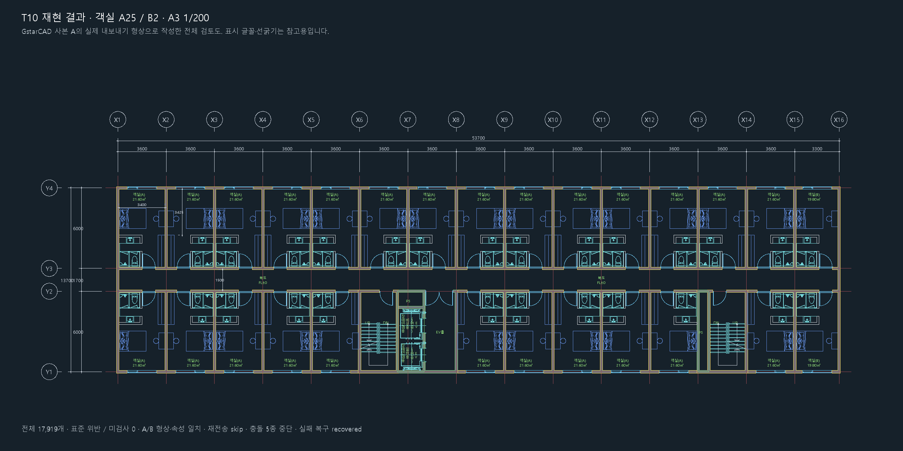

# T10 실행 기록

계획: [2026-10-16-t10-dangsan-acceptance.md](plans/2026-10-16-t10-dangsan-acceptance.md)

상태: 기준 입력 사용자 확인, 실제 CAD·MCP 재현 및 보호 시험, 독립 검토 수정·강화 비교 완료. 최종 전체 테스트와 PR·CI 확인 전이며 T10 최종 통과 전이다.

- 2026-10-16: T9 `3af52ec`에서 `t10-dangsan-acceptance` 생성. PR #21은 open/unmerged이므로 T9 기반으로 진행.
- 기존 `AGENTS.md`는 사용자의 미추적 파일로 보존한다.
- 입력: 작업 폴더의 원본 DWG와 기존 output 비교본. 기존 10실 합성 명세는 실제 27실 통과 근거로 사용하지 않는다.

## 기준 입력 고정

- 원본 SHA256: `3a77a39697ee713aa30bfee367d2bc810761fdf5f183952f6ee9d388a18f0a63`.
- 비교본 SHA256: `6b30a0f02977031ac2e71c1ff7a95c037f90dfe3069460dd3c6b156878562f3c`.
- 스냅샷: `snap-20261016-143649-cb6126`, `snap-20261016-143655-9b1010`. 두 원본 도면 ID는 같아서 경로·해시를 함께 기록한다.
- 로컬 준비 패키지: `output/t10/prepared-06/`. 선택 핸들·레이어 전체 매핑과 축좌표 20개 대조는 `baseline-review.md`, 원시 기대 형상·주석·해시·스냅샷 메타데이터는 `manifest.json`.
- 원본 203개 선택 → 표준화·상세 전개 553개. 다른 평면·대지·옛 도곽·옛 치수는 제외. 코어 문자 내용·기준점은 보존하되 높이·스타일·정렬은 현재 표준에 맞췄다. 승강기 내부 문자 34개는 TXT, UP/DN 4개는 TXT/stair_updn.
- 기준 DXF 형상 553/553, 최대 편차 `0.0000060562 mm`, 위반·미검사 0. GstarCAD 기준 DWG 재내보내기에서도 형상·속성 553/553 일치, 위반·미검사 0.
- 기준 DWG: `C:\arcaid\work\t10-baseline-20261016-1630\baseline.dwg`, SHA256 `c8b25187f02eb79f42b9001a20ce0655c035d3c460aa9fd89e289ec85b8defff`.
- 사용자가 미리보기·대조표를 확인하고 **“확정하고 객실 재현·보호 시험 진행”**을 선택했다. `human-confirmation.json`에 확인 당시 manifest와 고정 기준 해시를 남겼다. 이후 같은 객실 형상을 repeat로 압축했으며 기준 입력·비교본 기대값은 바꾸지 않았다.

## 순수 엔진 사전 검증

| 요청 | 객체 수 | 그룹 깊이 | 비교본 대조 |
|---|---:|---:|---|
| t10-rooms | 17,264 / 상한 20,000 | 2 / 상한 4 | 전부 일치, 최대 오차 상한 0.002482678 mm |
| t10-annotations | 102 / 상한 20,000 | 0 / 상한 4 | 전부 일치, 최대 편차 0.000000491 mm |

객실 재사용 그룹은 A/B 두 종류다. 기구·가구 상세는 중첩 그룹이며 양축 반전은 회전 180도로 표현했다. ELLIPSE 81개를 폴리라인으로 근사했다. 해치 비교는 꼭짓점 시작 순서·진행 방향 차이를 허용하고 실제 외곽·섬 좌표 변경을 검출한다. 기대값은 비교본 원래 객체를 WCS로 전개해 고정하며 새 명세 전개 결과에서 재생성하지 않는다.

## 실제 CAD·MCP 결과

[원래 GstarCAD 캡처](images/t10-cad-result.png), [기준 입력 검토도](images/t10-baseline-overview.png), [수치 결과 JSON](t10-acceptance-results.json).

GstarCAD 2021의 독립 사본 A/B에서 **각각 17,919개 = 기준 553 + 객실 형상 17,264 + 주석 102**를 확인했다. ROM의 정확한 `객실(A)` 25개, `객실(B)` 2개이며 욕실·침대·문·창의 상세 전부를 비교본과 대조했다. 전체 표준 위반 0, 미검사 0, 자동 수정 적용 0건이다. 두 사본은 핸들·태그·대상 ID를 제외한 형상·속성이 일치한다.

| 항목 | A | B |
|---|---:|---:|
| 읽기·기준 확인(초, Export 제외) | 1.203 | 1.281 |
| 객실 적용(초) | 32.919 | 34.529 |
| 주석 적용(초) | 25.231 | 25.005 |
| 전체 검사(초) | 3.337 | 2.564 |
| 객실 재전송(초) | 22.529 | 22.245 |
| 주석 재전송(초) | 7.223 | 9.597 |

준비·명세 작성 전체 7.769초. 최초 실제 CAD 시험 1개가 594.15초에 통과했다. 재전송은 같은 op·같은 명세로 skip, 객체와 기존 상태 불변이다. 다른 입력·일부 삭제·문자·레이어·버블 속성 변경은 각각 별도 사본에서 conflict·추가 변경 없음으로 확인했다. 실패 주입은 recovered, 핸들 553개와 형상·속성 복귀, 새 태그 객체 0개다. 원본 두 파일의 해시·mtime 및 사용자 열린 목록·활성·저장 상태가 보존됐다.

공개 MCP stdio에서도 새 사본에 `get_standard` 5개 섹션 → export_snapshot → read_drawing → draw_batch 2회 → check_standard → 재전송 2회 → DWG 저장을 실행해 passed를 확인했다. Export 1.280초, 읽기 0.598초, 객실 30.807초, 주석 23.146초, 전체 검사 7.496초, 재전송 18.961/7.268초다. 해당 MCP 결과도 원래 비교본 기대값과 일치하고 위반/미검사 0이며 원본·사용자 상태를 보존했다. 이 수치는 성능 기준선이며 임의 속도 합격선은 두지 않았다.

식별자:

- 표준: `heo-2026@2026.1`, k=200, op=`t10-rooms`/`t10-annotations`.
- A 도면: `{BD1E7721-4743-402E-8178-E1E32F5D9187}`, 최종 대조 스냅샷 `snap-20261016-210744-61c2bd`.
- B 도면: `{9573E7F5-D85D-4A5E-8F5D-1D53EC0DF3D7}`. 전체 스냅샷 목록은 로컬 증거 JSON에 남겼다.
- MCP 최종 스냅샷: `snap-20261016-211726-5f6fb8`.
- 실행 manifest: `73b5e9682ccb9321dd2a073e8aa14651ac48e404d5d9c02e9b673b77adb712fb`.
- 강화 검증 manifest: `ae08c1007aff576a6118aab8468ba088fef1adaec96dbf5468729032921ea59c`.

## 독립 검토 및 최종 강화 검사

[독립 검토 처리 기록](t10-code-review.md): Critical 0, Important 3, Minor 0. 실제 도면 손상은 없었으나 비교기의 허위 통과 공백을 찾아 한 번의 수정 단계에서 해결했다. 곡선·대각 오차·폐합·해치 채움 의미·초과 객체 반례 9개가 RED→GREEN으로 바뀌고 순수 시험 26개가 통과했다.

고정 좌표·형상·주석, 기준 DXF와 작도 명세는 바꾸지 않았다. 실행 당시 manifest를 보존하고 동일한 원래 비교본에서 해치 채움 설정·경계 역할 메타데이터만 더했다. 강화 비교기로 실제 A/B/MCP의 17,264개 형상과 102개 주석, 기준 DXF/DWG 553개를 모두 다시 통과했다. 기준 형상의 최종 보수적 편차 상한은 `0.0000119512 mm`, 객실은 `0.002482678 mm`로 모두 0.01mm 이내다. 강화 검사로 충돌 전후·복구 전후의 핸들과 형상·속성도 다시 대조한다. 공개 API·프로파일은 변경하지 않았다.

## 로컬 산출물과 재실행

- 결과 DWG: `output/t10/dangsan-A.dwg`, `output/t10/dangsan-B.dwg`(작업 원본은 `C:\arcaid\work\t10-acceptance-20261016-01\test_real_dangsan_reproduction0`).
- 기준 DWG와 검토 자료: 위 기준 입력 고정 항목 참조. 명세·manifest·사람 확인·강화 대조·MCP 결과: `output/t10/prepared-06/`.
- 원래 CAD 증거: 작업 원본 폴더의 `t10-evidence.json`. 기본/해당 CAD/MCP 시험 로그는 `output/t10/`.
- 실무 DWG·전체 명세는 커밋하지 않는다. 저장소에는 준비·비교 도구, 합성 회귀시험, 실제 CAD opt-in 시험과 요약 증거·이미지를 남긴다.

재준비는 `.venv/Scripts/python.exe tools/acceptance/t10_dangsan.py <원본 snapshot DXF> <비교본 snapshot DXF> --out <존재하지 않는 새 output 폴더> --source-dwg <원본 DWG> --reference-dwg <비교본 DWG>`로 한다. 실제 CAD 시험은 확인된 manifest 해시를 `ARCAID_T10_APPROVED_MANIFEST_SHA256`, 폴더를 `ARCAID_T10_PREPARED`, `ARCAID_CAD_TESTS=1`로 지정하고 `pytest tests/cad/test_t10_dangsan_cad.py --basetemp=<C:/arcaid/work 아래 존재하지 않는 새 경로>`를 실행한다. **기존 폴더를 basetemp로 재사용하면 pytest가 정리하므로 반드시 새 경로인지 확인한다.**

## 관찰·검사 한계

- 기준 사본에서 Export 후 saved=True→False 경고가 관찰됐다(T9과 동일 종류). 원인 미확정. 도면 이름·경로·형상은 보존됐고 원본 두 파일 및 사용자 상태는 변하지 않았다. 실제 시험의 스냅샷 경고를 모두 보관한다.
- 네이티브 CAD 캡처가 현재 화면 배율에서 전체 도면을 담지 못해 전체 검토용 벡터 미리보기를 함께 제공했다. 원래 캡처도 보관한다.
- 표준 검사 범위 밖: 블록 내부 정의·의미적 레이어 적합성, 해치 패턴/CTB, 치수·버블 간격의 자동 판정, 설계 적정성, 레이아웃·Xref 내부. 형상·축·주석 독립 대조는 별도의 통과 근거다.
- 현재 비교본 927개, 이전 기록 943개: 16개 차이. 상세를 기본 객체로 전개하므로 최종 객체 수는 이 숫자와 직접 비교하지 않는다.
- Claude Docs 원본은 편집 연결이 없어 로컬 계획 사본만 갱신했다.
