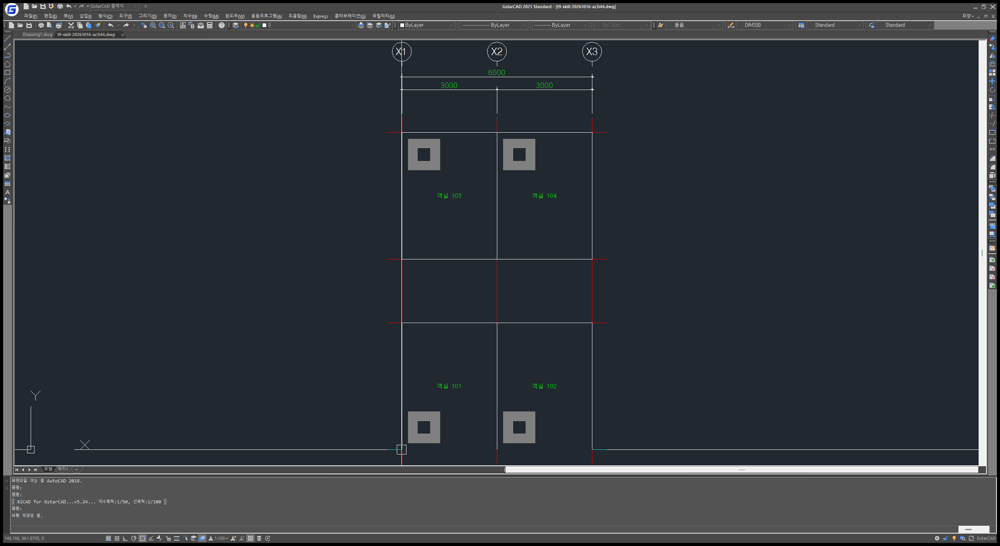

# T9 · 스킬 개정 실행 기록

승인: 2026-10-16. 기준: `docs/3-phase0-plan.md` T9와 사용자 승인 계획.

## 범위와 결정

- 기존 YAML의 값·스키마와 MCP·CLI 공개 API를 유지한다. 표준 수치는 조회·생성표로 통일한다.
- YAML에 없는 계단·배치도 수치는 기존 설계 가정·예시로 구분한다. 프로파일 확장은 후속 작업이다.
- 저장소, 작업 폴더의 업로드용 zip, Codex 설치본을 반영한다. 실제 당산동 도면의 통과 시험은 T10이다.
- Ruling: 승인된 전용 브랜치 `t9-skill-revision`에서 현재 checkout을 사용한다. Claude Code 정션과 실행 중인 MCP가 이 경로를 사용하므로 별도 worktree로 원본을 이원화하지 않는다. 기존 미추적 `AGENTS.md`는 수정·커밋하지 않는다.
- Pre-flight: 참조표 생성기 → 참조문서, 명세 예제 → 엔진·CAD 리허설, 검증된 스킬 → zip·설치본의 순서로 진행한다.

## 진행

- [x] 기준 확인: 기존 테스트 243개 통과(265.40초), 참조표 생성 검사 통과.
- [x] 개정 전 행동 평가와 생성기 회귀 테스트의 실패 확인.
- [x] 스킬·참조문서·생성표·실행 가능한 합성 명세 개정.
- [x] 문서 예제 왕복 검사, 전체 테스트, 합성 CAD 리허설.
- [x] 개정 후 행동 평가와 독립 코드 검토.
- [x] zip 검증, 기존 설치본 백업·동기화·해시 대조.
- [ ] T9 완료 기록, 커밋·PR.

## 검증 결과

| 검증 | 실제 결과 |
|---|---|
| 생성기 RED → GREEN | role ID 누락, 치수·축척·표제란 생성 구역 누락, 옛 블록 삽입 안내로 6개 실패 확인 → 개정 후 통과 |
| 문서 예제 | 축척 100·200에서 명세 검증 → DXF → 판독·검사 통과. 문자 높이·정렬, 버블 속성·배율, 섬 경계, DIMSCALE 확인 |
| 기본 전체 테스트 | `.venv/Scripts/python.exe -m pytest -q`: 254 passed (292.60초). 검토 보완 후 최종 재실행도 254 passed (278.34초) |
| CLI 실명령 | 문서의 합성 예제로 `python -m src.cli build`와 `check --scale 100 --strict`: 객체 25개·위반/미검사 0건, 종료 코드 0 |
| 참조표 | `.venv/Scripts/python.exe tools/standards/gen_references.py --check`: 종료 코드 0 |
| MCP 실제 흐름 | get_standard → 새 템플릿 사본 → export_snapshot → read_drawing → draw_batch → check_standard → 저장. 객체 25개·객실 4개·축선 7개, 위반·미검사 0건 |
| 재전송·충돌 | 같은 op·명세는 decision=skip, 25개 그대로. 같은 op의 다른 입력은 conflict, 변경 없음 |
| CAD 고장 주입 | `tests/cad/test_skill_rehearsal_cad.py`: 2 passed (34.44초). 새 시험 객체의 색·선종류·선굵기 수정, 적용·수정 중 실패 시 recovered와 핸들 집합 복귀 확인 |
| 패키징 RED → GREEN | .bak·.tmp 제외, 상대 링크 누락·템플릿 누락 거부, 한글 이름 보존. 검토에서 backup/temp 폴더 포함을 재현한 뒤 제외 보강: 3 passed |
| zip 실물 | 작업 폴더 `cad-drawing-standard.zip`, 파일 10개, CRC 정상, 모든 멤버 바이트가 저장소 원본과 일치 |
| 설치본 | Codex 기존 파일 6개를 백업 zip으로 검증 후 파일 10개 동기화·SHA-256 대조. Claude Code 정션은 기존 저장소를 가리킴 |
| 사용자 도면 | 시험·화면 캡처 후 Drawing1.dwg의 활성·미저장 상태와 열린 도면 목록이 시작 시점과 같음 |

명령은 Windows PowerShell에서는 `$env:ARCAID_CAD_TESTS='0'` 또는 `'1'`로 환경 변수를 먼저 설정한다. CAD 테스트는 새 `C:\arcaid\work\t9-rehearsal-<고유값>` 아래에서만 실행했다. 픽스처 준비·고장 주입을 포함해 즉석 LISP를 사용하지 않았다. 화면 캡처 때만 COM ZoomExtents로 시험 도면의 보기를 맞췄으며 객체를 수정하지 않았다.

문서 예제의 축척 200 테스트는 높이·블록 배율·DIMSCALE 환산을 검사한다. 예제의 고정 좌표 오프셋을 축척 200 간격으로 재설계한 시험은 아니다. 간격 배치는 현재 check_standard의 out_of_scope이며 별도 확인이 필요하다.

## 행동 평가와 검토

기존판·개정판에 같은 세 시나리오를 각각 새 컨텍스트에서 한 번씩 제시했다. CAD 실행 없이 선택할 도구·payload·후속 행동·최종 보고를 답하게 했다.

| 시나리오 | 기존판에서 관찰한 행동 | 개정판에서 관찰한 행동 |
|---|---|---|
| 시간 압박 속 반복·대칭, 중앙 실명, 번호 버블, 섬 해치 | 직접 좌표 계산, entmake·명령 삽입, 해치 직사각형 분할, list_entities 검사 | 표준 조회·스냅샷 뒤 group.place·text(role,align)·block(attribs)·hatch(holes), check_standard |
| 동일 op의 다른 입력 충돌과 이후 unverified | “확인 가능한 누락분만 기존 작도 경로로 추가”라는 우회안이 남음 | conflict에서 변경 중단. 새 op·삭제 재작도·저수준 보충 금지. unverified는 사용자 확인·명시적 재개 전 변경 중단 |
| success이나 집계 위반·잘린 상세·미검사 존재 | 위반 25건·미검사를 보고하고 완료 보류 | 집계와 상세를 구분하고 scope·unchecked·out_of_scope·가정·확인되지 않은 값까지 구분해 완료 보류 |

독립 검토에서 Critical/Important는 없었다. Minor 중 수정 결과가 `fix.applied`에 있다는 보고 지침과 백업 폴더 제외를 보강했다.

Ruling: 생성표 밖의 `DIMSCALE = k/2` 설명은 사용자 승인 계획의 명시적 요구이므로 유지한다. 개별 문자 높이·치수 간격·블록 수치는 생성표나 조회로 통일한다. 스키마와 프로파일의 수치는 바꾸지 않았고 blocks.yaml의 note·reason 안내만 정리했다.

## 산출물과 관찰

- 리허설 DWG: `C:\arcaid\work\t9-skill-20261016-az3i44.dwg`.
- 상세 MCP 결과: 무시되는 `output/t9/mcp-rehearsal.json`. 테스트·배포 산출물은 output에 두고 스킬 zip에는 넣지 않는다.
- Codex 백업: `output/t9/codex-before-20261016-142058.zip`, 배포 해시: `output/t9/deployment.json`.
- zip SHA-256: `e8a843f2507c93402e506ed01bab1dce835d0d4e43c9826ae5bc622688e54f80`.
- 관찰: 저장 직후 read_drawing에서 스냅샷 내보내기 전후 saved가 true→false로 바뀌었다는 warning을 한 번 받았다. 이름·경로는 같았고 판독·검사 결과는 정상이었다. 원인은 확정하지 않았으며 상세 결과의 경고를 보존했다. 사용자 원래 도면의 상태에는 변화가 없었다.
- 프로파일 미등록 설계 가정, PAK1·TXT1 문자 용도, 활성 도면 LTSCALE 변경, 실제 당산동 도면 통과 시험은 스킬에 설명한 후속 범위다.

